# Product Demo Engine

The Product Demo Engine turns the current product definition into a navigable,
local simulation. It is part of the existing Product Experience/report flow:
it reads persisted PDLC state and does not run discovery a second time. Its
design tokens and rendering rules are independent from the Tramuri report
design system.

## Contents

- [Flow and modules](#flow-and-modules)
- [Supported categories and templates](#supported-categories-and-templates)
- [Versioned artifacts](#versioned-artifacts)
- [Ambiguity and correction](#ambiguity-and-correction)
- [Visual design and skill routing](#visual-design-skills-and-source-notes)
- [Limitations](#limitations)

## Flow and modules

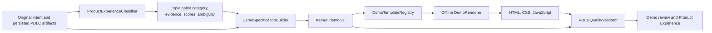

- `src/tramuri/experience/classifier.py` combines weighted context fields for
  original intent, platform, description, workflows, features, constraints,
  audience, decisions and evidence. It records candidate scores and matched
  source evidence. The implementation is deterministic and local; it uses
  contextual cue families, not a model or an unrecorded guess.
- `spec.py` extracts the existing product name, description, audience,
  features, constraints, platform and primary journey into a versioned spec.
  Each screen/action maps to artifact kinds so later renders do not reconstruct
  discovery decisions.
- `registry.py` maps categories to independently registered templates.
  Extensions can register a category's cue family and template without adding
  renderer branches to the workflow. Registered templates also provide default
  screen and action metadata.
- `renderer.py` builds the environment and local interaction script. It escapes
  product content and uses system fonts and local assets only.
- `demo.py` publishes to `tramuri_output/demo/` and returns the surfaces through
  the current Product Experience contract.
- `sensors.py`, `reviewer.py` and optional `browser.py` validate generated
  files, links, screens, interactions, source traceability, accessibility
  signals, responsive rules, contrast, offline operation, category
  representation, placeholders and browser journeys.

The existing `ReportGenerator.generate()` invokes `ProductDemoBuilder`; the CLI
also exposes `tramuri experience render RUN_ID` for a re-render. No new
dependency, service, database or alternate workflow is introduced.

## Supported categories and templates

| Category | Template | Visual environment and example interaction |
| --- | --- | --- |
| `mobile_app` | `mobile` | Smartphone with safe-area padding, app navigation and local expense/next-step state |
| `web_saas` | `web` | Browser-oriented domain surface: service booking, education, marketplace or project board |
| `cli_developer_tool` | `cli` | Monospaced terminal and a fixed allowlist of command scenarios |
| `desktop_app` | `desktop` | Application window, workspace tools and local settings save |
| `api_backend` | `api` | Editable local request and JSON response/error preview; no network call |
| `data_ai_pipeline` | `pipeline` | Ingest/transform/publish stages and synthetic execution status |
| `iot_hardware` | `iot` | Device view and adjustable local sensor telemetry |
| `hybrid` | `hybrid` | Connected mobile field surface and operations web view with shared local state |
| `other` | `other` | Contextual, explicitly inferred concept flow |

The web template chooses a domain route using `DemoSpecification.domain`:
learning journeys use catalog/enrollment/progress, appointment products use
booking/availability, marketplaces use storefront/product/basket and a separate
seller perspective, and project workspaces use an interactive board. New
domains should be added to the registry or a focused renderer and covered by a
fixture, not translated into a generic dashboard.

## Versioned artifacts

Each generated demo includes:

- `demo_spec.json` (`tramuri.demo.v1`): classification, context, screens,
  interactions, platform, proposed/supplied identity and source artifact kinds;
- `traceability.json` (`tramuri.demo-traceability.v1`): screen/action to source
  mappings and an explicit synthetic-data boundary;
- `index.html`, `styles.css`, and `app.js`, plus domain-justified pages such as
  learning, booking or operations surfaces.

`ProductDemoBuilder.render_spec(path)` re-renders from a validated spec without
re-running framing or discovery. The renderer rejects unregistered template
ids and category/template mismatches.

## Ambiguity and correction

Classification uses strong context for platform and intent and supporting
signals for features, audience, constraints, decisions and user flows. Hybrid
requires multiple supported surfaces connected by a journey. A weakly
supported category becomes `other` with `ambiguous: true` and an evidence note;
the concept template signals the inference.

Inspect and correct a persisted run with:

```powershell
tramuri --project-dir .tramuri-demo experience status RUN_ID
tramuri --project-dir .tramuri-demo experience render RUN_ID --category desktop_app
```

The correction is stored as an `experience.classification_override` decision
event and reused by subsequent Product Experience renders. Built-in override
values are the initial categories listed above.

## Visual design, skills and source notes

All ten requested design/testing skills were found installed under
`tramuri-harness-kit/.agents/skills/`. Their routing is recorded in
`tramuri-harness-kit/harness/core/policies/skill-selection.md`, and the
generation contract lives in
`tramuri-harness-kit/.agents/skills/tramuri-product-demo-engine/SKILL.md`.

| Skill | Applied decision |
| --- | --- |
| `frontend-design` | Used for product-specific hierarchy, domain templates and visual critique; not a shared generic dashboard |
| `ui-ux-pro-max` | Evaluated local search results; its generic web portal recipe did not fit a multi-category offline engine, so no preset was copied |
| `impeccable` | Available, but not run because its detector/context setup targets a concrete product interface rather than this category-wide reusable engine |
| `theme-factory` | Available; not used because it requires choosing a preset theme, while the engine must propose domain tokens without user selection |
| `web-design-guidelines` | Applied after rendering for landmarks, labels, focus, reduced motion, contrast, overflow and local-resource checks |
| `mobile-app` | Used only for device proportion and safe-area ideas; its one-screen iPhone archetype was not used as a complete journey |
| `mobile-design` | Applied to the mobile frame, touch targets, narrow layouts and cross-platform proposal |
| `silent-product-demo` | Available but not applicable: it produces silent video/storyboards rather than the requested interactive local artifact |
| `webapp-testing` | Select when Playwright and browser capability are available; otherwise report browser validation as `not_run` |
| `data-visualization` | Applied to stage clarity and tabular text alternatives; no unsourced numeric chart is generated |

The terminal decision follows tool contracts: [xterm.js](https://xtermjs.org/docs/)
provides a full terminal frontend but needs a terminal backend for arbitrary
command execution; [asciinema's player](https://docs.asciinema.org/manual/player/)
plays recorded sessions; and [terminal-demo](https://github.com/steelydylan/terminal-demo)
supports scenario playback with extra JS packaging choices. The Tramuri CLI
template therefore uses its own small browser simulator with an explicit
allowlist. It is interactive, predictable and never starts an operating-system
shell.

The post-render review follows the current
[Web Interface Guidelines](https://raw.githubusercontent.com/vercel-labs/web-interface-guidelines/main/command.md):
semantic labels, visible keyboard focus, reduced-motion support, readable
contrast, resilient narrow layouts and no external asset requests. Deterministic
Python sensors check measurable signals; they do not replace visual browser
review when the browser exists.

### Screenshot examples

These browser captures show representative generated templates. The sample
content is synthetic and does not claim a live integration or product release.

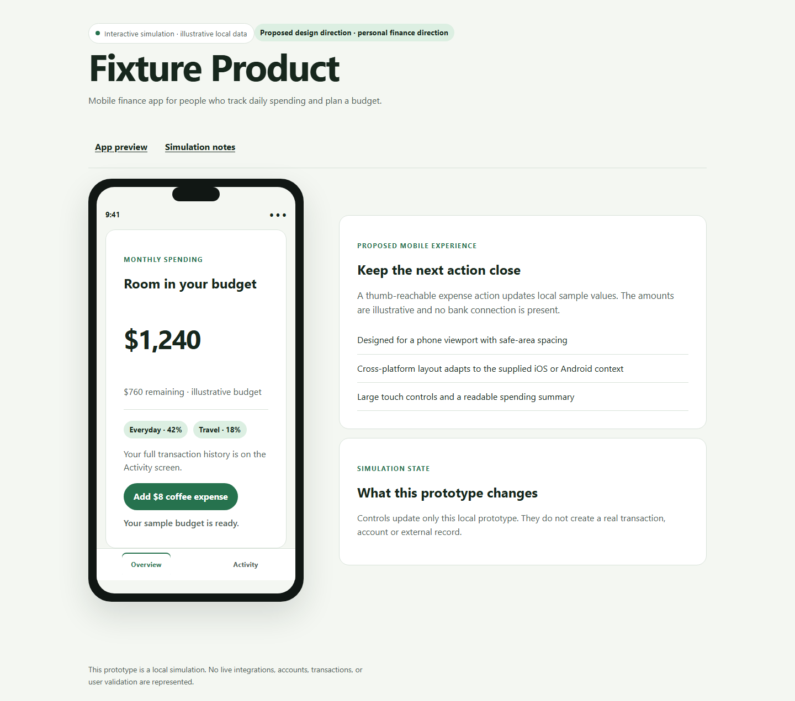

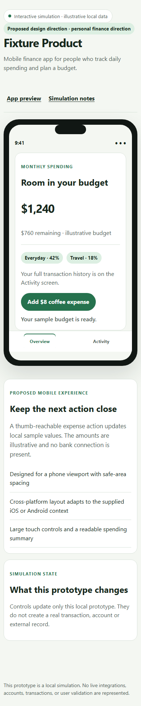

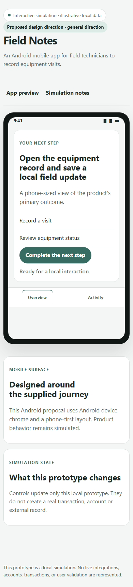

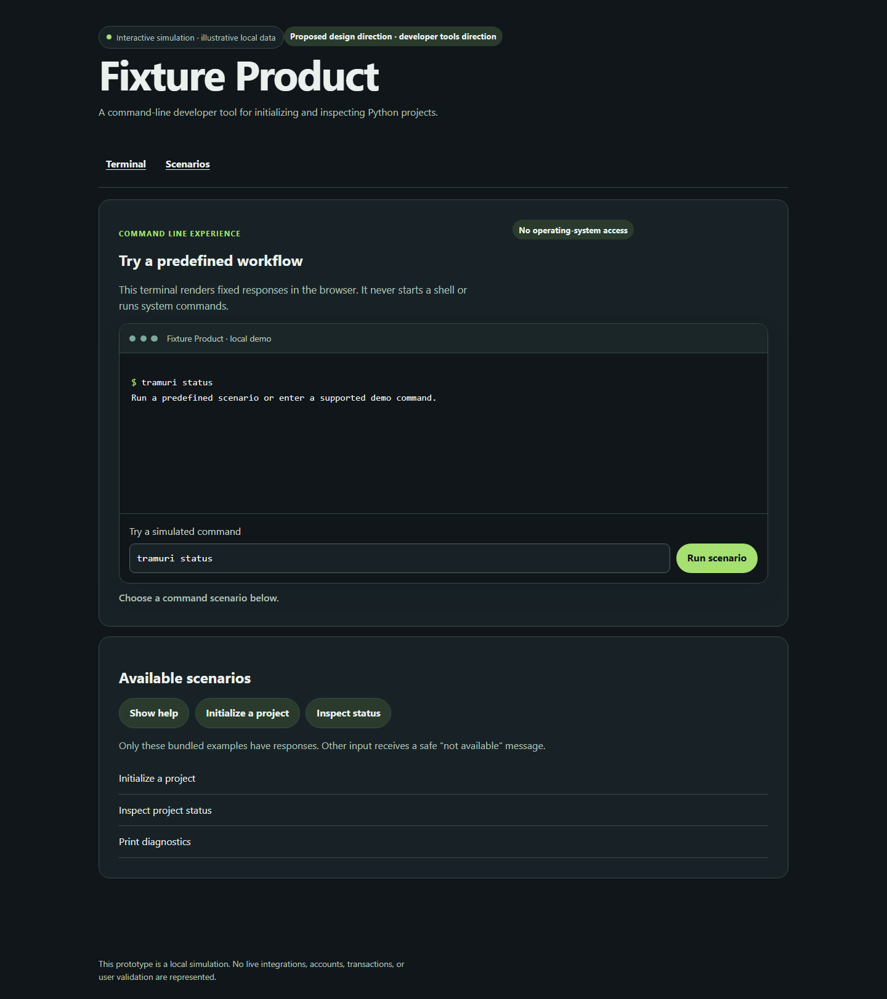

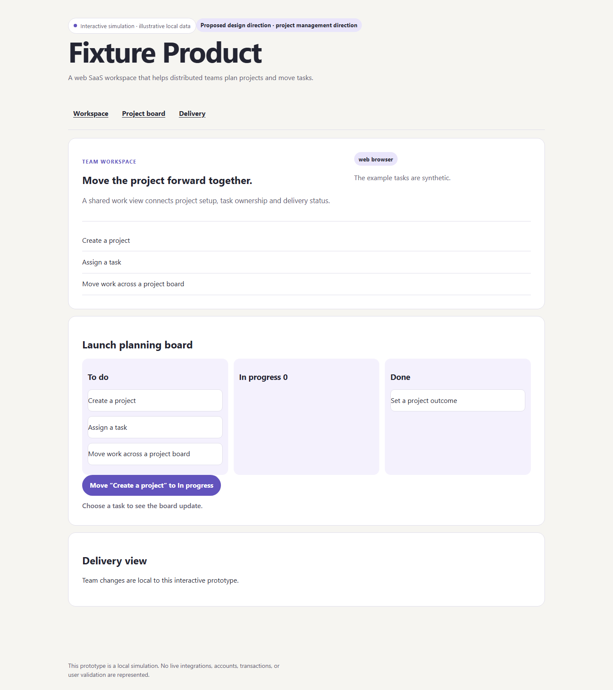

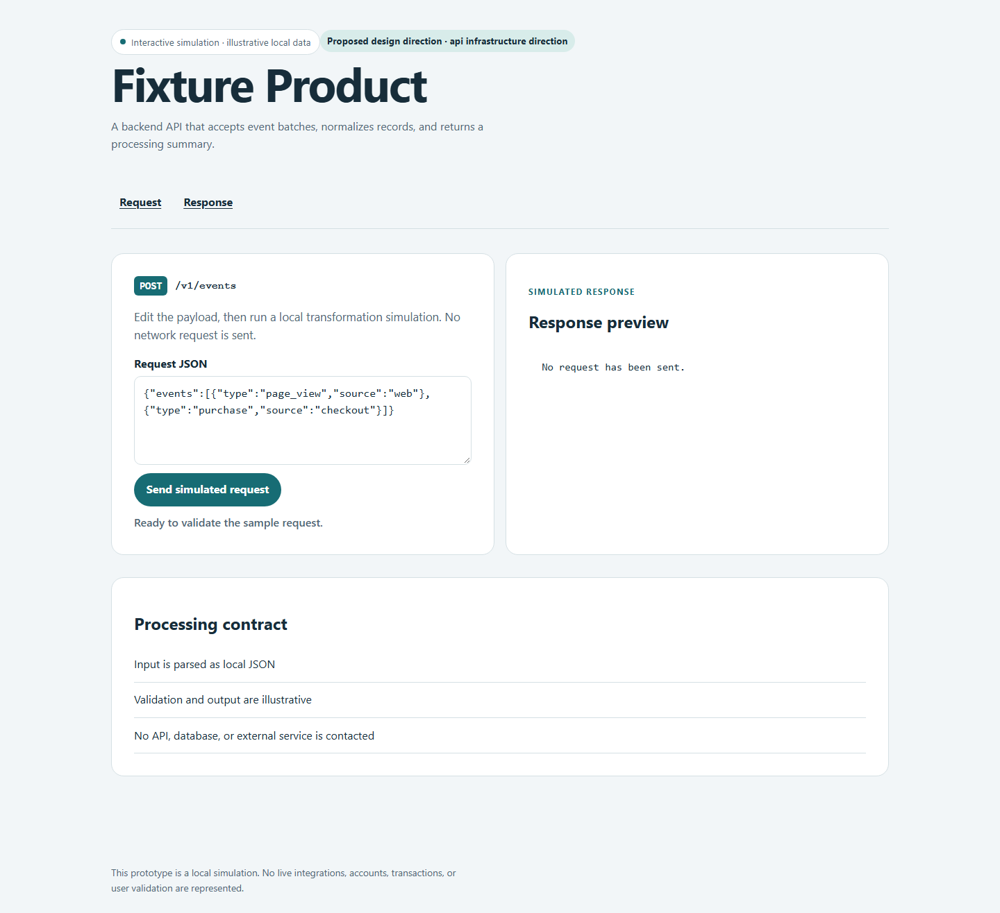

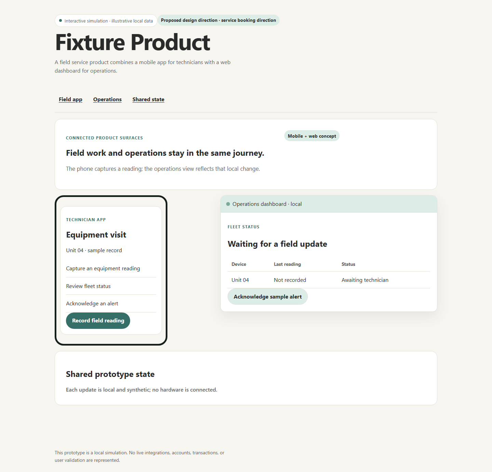

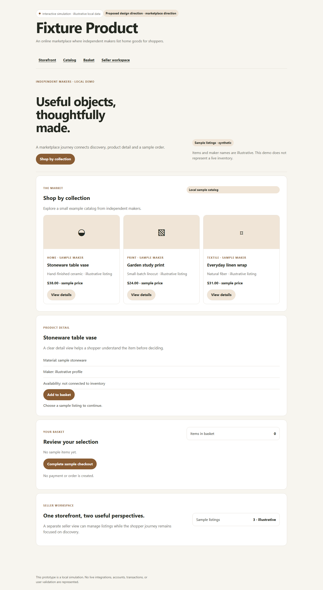

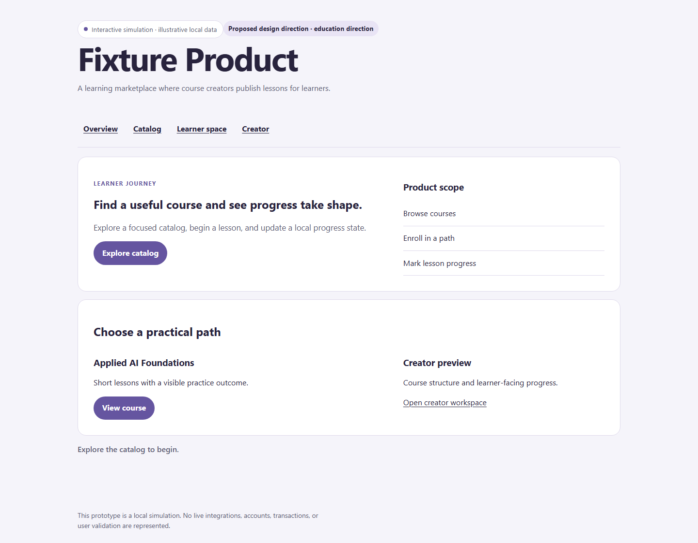

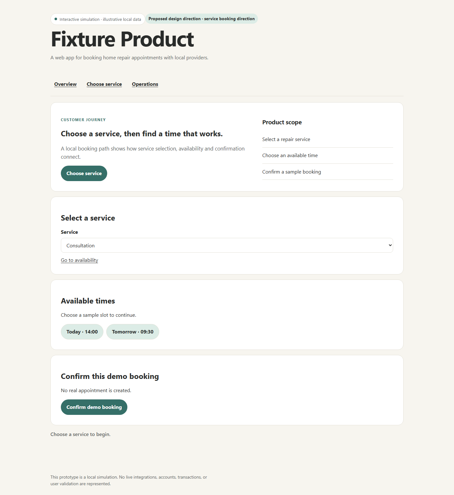

Desktop and mobile captures for the initial fixture set are in
`docs/assets/product-demo-engine/`.

## Limitations

- The local classifier is explainable and cue-based, not an LLM/embedding
  classifier. It can return `other` or an incorrect category when product
  wording and artifacts are sparse; confidence/evidence and the correction
  command make that recoverable.
- Category-specific text, sample data and screens remain template proposals.
  Their presence does not prove production implementation, integration or user
  validation.
- Browser validation is optional and Playwright is not a project dependency.
  Normal runs report browser testing as `not_run` unless it is separately
  available.
- Brand colors are read from supported PDLC fields when valid; unsupported
  identity formats fall back to a labeled domain proposal.
