# Fluxo de execução de Product Engineering no Tramuri

Este diagrama mostra como o Tramuri organiza uma Mission de Product Engineering, desde a intenção
até a entrega e o aprendizado. Ele distingue as operações locais do Tramuri das ações realizadas
pelo agente hospedeiro e suas ferramentas.

```mermaid
flowchart TD
    A[Usuário descreve o objetivo em linguagem natural] --> B{Integração Tramuri ativa<br/>e hook nativo habilitado?}
    B -- Sim --> C[Hook fecha o gate no início do turno]
    B -- Não --> C2[Skill e instruções orientam o fluxo<br/>sem enforcement garantido]
    C --> D[Preflight direto: versão, status e lista de Missions]
    C2 --> D
    D --> D1{Já existe Mission aberta<br/>que corresponde ao objetivo?}
    D1 -- Sim --> E[tramuri resume --mission ID]
    D1 -- Não --> F[tramuri start --goal objetivo]
    D1 -- Escolha ambígua --> Q[Perguntar somente o necessário<br/>e reavaliar no próximo turno]
    Q --> D
    E --> G{CLI terminou com sucesso?}
    F --> G
    G -- Não --> H[Gate continua fechado;<br/>corrigir seleção ou esclarecer objetivo]
    H --> D
    G -- Sim --> I[Gate libera ferramentas locais<br/>neste turno]

    subgraph INICIO[Início · DEFINE]
        I --> J[Carregar tramuri-product-engineering<br/>se a perspectiva for Product Engineer]
        J --> K[Agente prepara Product Brief:<br/>intenção, conhecidos, hipóteses, decisões,<br/>riscos, recomendação e próximo passo]
        K --> L{Há decisão material<br/>que o agente não pode inferir?}
        L -- Sim --> M[Apresentar opções, consequências<br/>e uma pergunta objetiva]
        M --> N[Registrar como decisão somente<br/>após confirmação do usuário]
        L -- Não --> O[Continuar com hipótese reversível<br/>claramente identificada]
        N --> P[Atualizar foco da Mission<br/>e registrar conhecimento autorizado]
        O --> P
    end

    subgraph MEIO[Meio · BUILD]
        P --> R{Usuário pediu construção<br/>ou próximo artefato?}
        R -- Não --> S[Entregar definição, MVP proposto,<br/>exclusões, riscos e critérios candidatos]
        R -- Sim --> T[Agente usa ferramentas disponíveis<br/>no host para criar protótipo ou produto]
        T --> U[Executar testes apropriados<br/>no ambiente do projeto]
        U --> V[Registrar execução e resultado observado<br/>com as interfaces do Tramuri]
        V --> W[Anexar evidência e proveniência;<br/>não declarar sucesso sem resultado real]
    end

    subgraph FIM[Fim · SHIP, VERIFY e LEARN]
        S --> X{Há critérios e evidências<br/>suficientes para avaliar?}
        W --> X
        X -- Não --> Y[Manter pendências explícitas;<br/>definir próximo passo ou handoff]
        X -- Sim --> Z[Avaliar cada critério<br/>com responsável e evidência]
        Z --> AA{Resultado agregado verificado?}
        AA -- Não --> Y
        AA -- Sim --> AB[Registrar Outcome verificado<br/>com as limitações da evidência]
        Y --> AC[Atualizar foco e registros autorizados]
        AB --> AC
        AC --> AD[Atualizar tramauri.html, .md e .json<br/>sem reabrir o navegador se já foi aberto]
        AD --> AE[Resumo de encerramento:<br/>o que mudou, pendências, resultado<br/>e próxima ação concreta]
        AE --> AF[Retomada futura: preflight e<br/>tramuri resume --mission ID]
        AF --> D
    end

    classDef tramuri fill:#e9f2ff,stroke:#2456a6,color:#13294b;
    classDef agent fill:#f3eaff,stroke:#7241a6,color:#30144f;
    classDef user fill:#fff3d6,stroke:#ad7612,color:#3e2c05;
    classDef caveat fill:#fff0f0,stroke:#b43b3b,color:#4b1515;
    class A,Q,M,N user;
    class C,D,E,F,G,I,P,V,W,Z,AB,AC,AD,AF tramuri;
    class J,K,L,O,R,S,T,U,X,AA,AE agent;
    class B,C2,H,Y caveat;
```

## O que o diagrama significa na prática

### Início

- O agente consulta o estado e as Missions existentes antes de explorar os arquivos ou usar outra
  ferramenta de trabalho.
- `status` e `mission list` são consultas de preflight: não criam nem selecionam uma Mission e não
  destravam o gate. Ao abrir um banco antigo, os comandos CLI podem executar as migrations aditivas
  já existentes; o hook não executa migrations por conta própria.
- Se existir Mission compatível, o agente retoma aquela Mission. Se não existir, inicia uma nova.
  Quando a escolha for realmente ambígua, pergunta antes de selecionar.
- Para Product Engineering, o Core inicia o foco em `product_framing`. Isso não significa que o
  Product Brief foi produzido: essa análise é feita pelo agente usando a skill pertinente.

### Meio

- A skill instrui o agente a apresentar primeiro um Product Brief e distinguir informação fornecida,
  observação com fonte, hipótese, recomendação e decisão aprovada.
- A CLI registra estado, foco, conhecimento, execução, evidência e avaliação. Ela não chama por si
  só o Codex, Claude Code, Cursor, Gemini CLI ou Copilot, não implementa o SaaS e não executa seus
  testes.
- Se o agente hospedeiro não tiver a ferramenta de criação necessária, ele deve comunicar a
  limitação e usar uma alternativa local viável quando disponível.

### Fim

- Um teste só pode ser relatado como executado se uma ferramenta o executou e seu resultado foi
  observado. A referência registrada no Tramuri não valida o sistema externo automaticamente.
- `Execution Completed`, evidência registrada e `Outcome Verified` são estados distintos.
- O relatório é atualizado ao final de uma sessão coerente que alterou registros. Gerar/atualizar o
  relatório não exige abrir o navegador novamente.
- Em um próximo turno, o hook bloqueia novamente as ferramentas locais até um `start` ou `resume`
  terminar com sucesso, desde que a integração e o hook nativo estejam ativos e confiáveis.

## Limites atuais

Este fluxo combina comportamento determinístico do Core/CLI com orientação executada pelo modelo.
O hook pode impor a ordem de ferramentas locais dentro dos limites de cada plataforma; ele não
garante que o agente produza um Product Brief de qualidade, carregue corretamente a skill, use uma
ferramenta externa, execute todos os testes, faça deploy ou valide um resultado de negócio.
Esses comportamentos ainda precisam de testes end-to-end em runtimes reais e pilotos com
Product Engineers.
