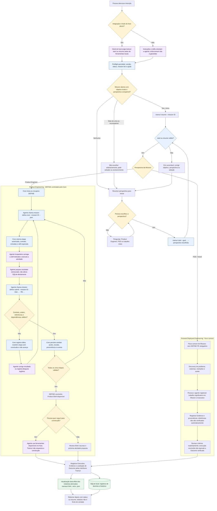

# Fluxo operacional completo do Tramuri

Este documento descreve o que o Tramuri controla de forma determinística, o que fica a cargo do agente hospedeiro e o que é persistido no SQLite. O foco é o início de uma Mission e os caminhos de Product Engineering (PE) e Forward Deployed Engineering (FDE), incluindo o workflow DEFINE de PE.

> **Limite importante:** as instruções, skills e hooks orientam o agente, mas não garantem que todo host vá segui-los. O Core controla as transições do DEFINE quando as operações passam pelo CLI. Ele não executa LLMs, skills, hooks ou servidores MCP.

## Visão ponta a ponta



## Como a perspectiva é escolhida

O perfil de trabalho é uma preferência de experiência, não uma identidade autenticada. O Core não usa a existência de uma skill como prova de que a pessoa é PE ou FDE.

1. Uma perspectiva informada explicitamente no início vence as demais opções e é registrada como explícita.
2. Para uma Mission nova, `ask_work_perspective = always` pede escolha quando não foi informada perspectiva, antes de aplicar a inferência da frase.
3. Fora do modo `always`, uma única classe de sinal reconhecida na intenção atual (`product` XOR `FDE`) prevalece sobre a preferência salva.
4. Se não houver sinal único, uma preferência configurada diferente de `auto` fornece o padrão.
5. Com sinais conflitantes ou sem sinal e sem preferência concreta, o Core retorna ambiguidade; o agente/CLI deve pedir uma escolha.
6. Uma Mission retomada mantém a perspectiva já registrada, salvo mudança explícita. A reutilização automática exige um único objetivo aberto com texto normalizado exatamente correspondente e perspectiva compatível; não há correspondência semântica aproximada.

O roteador não compreende qualquer frase em linguagem natural. Interpretações mais amplas podem vir do agente, mas são sugestões do host e devem chegar ao Tramuri como seleção explícita, não como garantia do classificador do Core. A escolha/registro no Core ainda deve passar por `start`/`resume` conforme o gate instalado.

**Ramo PE (sim):** perspectiva `product_engineer` inicia/recupera as cinco etapas sequenciais do DEFINE.

**Ramo FDE (não PE):** perspectiva `fde` segue o modelo comum de Mission, Discovery, Execution, Evidence e Outcome. O DEFINE de Product Engineering não é imposto ao FDE. Missões `mixed` ou `other` também não entram automaticamente no DEFINE PE.

## Etapas e skills do DEFINE

O `mission define next` é a autoridade para indicar a etapa atual e a skill esperada. O Core não carrega skills; isso é feito pelo agente segundo o host (Codex, Claude Code, Cursor, Gemini CLI, GitHub Copilot ou outro instalado e configurado).

| Ordem | Etapa | Skill indicada pelo Core | Resultado, em termos gerais |
|---|---|---|---|
| 1 | `objective_context` | `tramuri-pe-objective-context` | Intenção, objetivo, informação conhecida, hipóteses e lacunas |
| 2 | `business_discovery` | `tramuri-pe-business-discovery` | Problema, público, negócio, regras e incertezas |
| 3 | `requirements` | `tramuri-pe-requirements` | Requisitos candidatos, restrições e critérios candidatos |
| 4 | `knowledge_synthesis` | `tramuri-pe-evidence-hypotheses` | Síntese classificada de fatos, hipóteses, decisões e perguntas |
| 5 | `product_brief` | `tramuri-pe-product-brief` | Brief derivado dos artefatos anteriores e próxima atividade proposta |

`tramuri-pe-decision-support` pode orientar uma decisão material que bloqueia o avanço. Seu uso não substitui o registro da pergunta/resposta pelo Core. Skills e resultados são conteúdo não confiável até serem submetidos e validados pelas operações do Tramuri.

### Caminho de aprovação ou rejeição

- **Sim, válido:** o Core aceita o resultado da etapa atual, persiste sua revisão e referências, registra o evento e libera a próxima etapa.
- **Não, inválido:** o Core devolve erros, mantém a etapa atual sem conclusão e não libera a próxima. O agente pode corrigir e submeter de novo.
- **Decisão material pendente:** registrar a pergunta pelo comando de workflow; a etapa pode ficar bloqueada. O orçamento padrão de esclarecimentos do DEFINE é persistente e limitado a duas perguntas comuns.
- **Revisão de etapa aceita:** usar a operação explícita de revisão, com motivo e autor declarado. O Core preserva histórico e marca dependências afetadas como `stale`; o Brief não permanece atual se seus insumos mudarem.
- **Sem bloqueio material:** incertezas devem continuar classificadas como hipóteses/lacunas, não virar fatos ou decisões aprovadas para forçar avanço.

O fim do DEFINE significa que o Brief passou pelas validações implementadas. Não significa que produto foi construído, que o mercado foi validado ou que o Outcome da Mission foi verificado.

## O que é determinístico e o que não é

| Parte | Autoridade efetiva | Limite |
|---|---|---|
| Ordem e etapa liberada do DEFINE | Rust Core, persistida no SQLite | Vale para chamadas que passam pelo CLI/Core |
| Validação do contrato e referências suportadas | Rust Core | Validação estrutural não prova verdade de mercado ou qualidade semântica |
| Seleção/execução de skill | Agente hospedeiro, orientado pelo contrato do CLI | Core retorna o identificador esperado; não garante que o host carregou a skill |
| Pesquisa, síntese, recomendações e conteúdo do artefato | Agente e ferramentas autorizadas do host | Não são garantidos como corretos pelo Core |
| Avaliação semântica do Brief | Avaliador/host, com rubrica e resultado declarados | Probabilística/declarada; não é garantia determinística |
| Uso de hook | Plataforma do agente | Só cobre eventos e ferramentas realmente suportados pelo hook instalado |
| Outcome | Avaliação explícita de critérios ligada a evidências | `Execution completed` e uma referência registrada não comprovam Outcome por si sós |
| Relatórios | Projeção local dos dados disponíveis | São derivados, não fonte de verdade nem atualização ao vivo garantida |

## O que fica no SQLite

O banco `.tramuri/database/` mantém a fonte de verdade local. Os nomes abaixo descrevem as tabelas atuais em linhas gerais; mudanças futuras de schema precisam de migration compatível.

| Dados | Persistência atual |
|---|---|
| Mission e contrato | `missions`, `success_contracts`, `success_criteria`; objetivo e revisões do Success Contract |
| Perspectiva e próxima atividade | `mission_workflows` e `mission_work_perspective_history`, incluindo origem declarada da perspectiva e histórico de mudança |
| Workflow DEFINE | `define_workflows`, `define_steps`, `define_artifacts`, `define_questions`, `define_events`; versão/estado, etapa, tentativas, payload estruturado, revisão, dependências, validação e eventos |
| Knowledge e proveniência | `knowledge_records`, `evidence_references`, `knowledge_evidence`; tipo/status, evidências de origem e relações existentes |
| Trabalho executado | `executions`; Mission, contrato, ator declarado, estado e timestamps |
| Evidence | `mission_evidence`; tipo, locator, disponibilidade registrada e captura. O Tramuri não abre URL nem lê o arquivo referenciado para recuperar Evidence |
| Revisão de critérios/Outcome | `criterion_assessments` e `criterion_assessment_evidence`; critério, resultado, responsável/mecanismo declarado, explicação e referências de evidência |
| Perfil do workspace | `.tramuri/config.toml`; preferência de experiência, fora das tabelas de domínio |

`tramauri.html`, `tramauri.md` e `tramauri.json` são relatórios derivados. São atualizados por operações apropriadas conforme a implementação atual, sem reabrir o navegador a cada mudança. Uma página estática já aberta não é uma visualização ao vivo garantida; reabra ou atualize o relatório para consultar a projeção mais recente.

## Comandos que representam o ciclo do DEFINE

Exemplos de operações reais. `<ID>` representa uma Mission já resolvida; não escolha um ID arbitrariamente se houver mais de uma candidata.

```bash
tramuri start --goal "Criar uma plataforma de cursos" --perspective product_engineer
tramuri mission define status --mission <ID> --json
tramuri mission define next --mission <ID> --json
tramuri mission define submit --mission <ID> --step objective_context --file resultado.json --json
tramuri mission define review --mission <ID> --step objective_context --file revisao.json --reason "Nova informação" --author "operador" --json
tramuri resume --mission <ID>
```

Após cada submissão aceita, consulte `define next` novamente. O próprio retorno define a próxima operação válida. O agente não deve escrever nas tabelas diretamente nem declarar concluída uma etapa por texto.

## Leitura recomendada

- [Fluxo Product Engineering: DEFINE → BUILD → SHIP](product-engineering-execution-flow.pt-BR.md)
- [Hardening do DEFINE](define-hardening.pt-BR.md)
