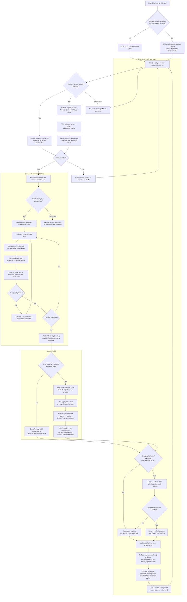

# Product Engineering execution flow in Tramuri

This diagram shows how Tramuri organizes a Product Engineering Mission from intent through delivery
and learning. It separates local Tramuri operations from work performed by the host agent and its
tools.

## What the flow means

### Start

- The host checks existing Tramuri state and Missions before inspecting files or using other work
  tools when a supported, trusted native hook is active. Instructions are guidance when hooks are
  unavailable, disabled, or bypassed.
- `status` and `mission list` are preflight queries; they do not create/select a Mission or unlock
  the hook gate. Opening a supported older database may apply its existing additive migrations.
- A new Mission requires an explicit choice among Product Engineer, FDE, or mixed. A terminal start
  presents a three-option selector; an agent asks in chat and passes the selected value. Defaults and
  intent inference can suggest but cannot choose. A unique exact open Mission match resumes with its
  stored perspective. Product Engineer `tramuri start` also initializes persistent DEFINE in the Core.
  A complete Success Contract is not required.
- The host calls `tramuri mission define next --mission <id> --json`, loads the returned skill,
  produces structured JSON, and submits it. The Core rejects out-of-order steps and does not advance
  after rejection. CLI transitions refresh local reports best-effort without reopening the browser.
- The five steps are `objective_context`, `business_discovery`, `requirements`,
  `knowledge_synthesis`, and `product_brief`. The Core checks structure and artifact references; it
  cannot prove market claims are true or verify that the host actually used a skill.

### Build

- Skills guide the cognitive work; the Core owns sequence, structural acceptance, persistence, and
  progress. `status` and `next` restore persisted state.
- The CLI records work; it does not call Codex, Claude Code, Cursor, Gemini CLI, or Copilot, build a
  product, or run its tests.
- If a preferred host tool is unavailable, the host should report that and use a viable local
  alternative when available.

### Ship

- A test is reported as executed only after a tool runs it and the result is observed. Recording a
  reference does not validate an external system automatically.
- `Execution Completed`, evidence recorded, and `Outcome Verified` are distinct states.
- Completing DEFINE stores a Product Brief; it does not start BUILD, create code/tests, or verify a
  business outcome.
- Reports are projections and can be regenerated from SQLite. Direct Python SDK workflow calls do
  not refresh CLI reports automatically; run `tramuri status --refresh` afterward.

## Current limits

This combines deterministic Core/CLI state transitions with behavior performed by a host model.
The hook only gates supported local tools within each platform's documented boundary. It cannot
guarantee product quality, skill use, external research, tool availability, test execution, deploy,
or business validation. Those require real host-runtime tests and Product Engineer pilots.
