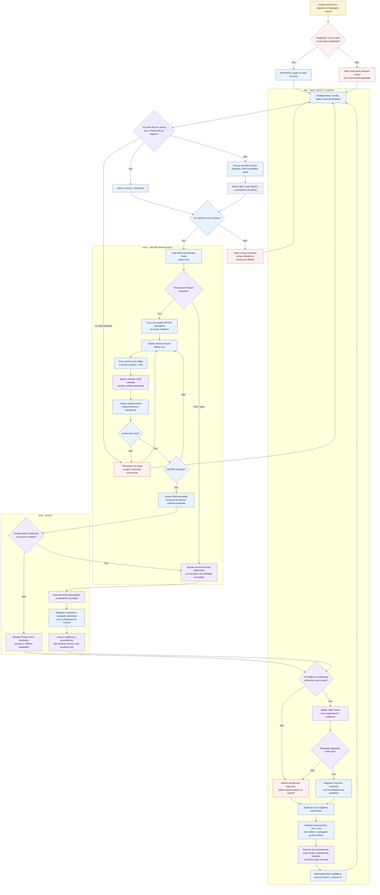

# Fluxo de execução de Product Engineering no Tramuri

Este diagrama mostra como o Tramuri organiza uma Mission de Product Engineering, desde a intenção
até a entrega e o aprendizado. Ele distingue as operações locais do Tramuri das ações realizadas
pelo agente hospedeiro e suas ferramentas.

Para os contratos de revisão de etapas aceitas, propagação `stale` e avaliação do Product Brief,
consulte [DEFINE: revisão, validade e avaliação](define-hardening.pt-BR.md).
Para o detalhe de roteamento PE/FDE, skills, operações determinísticas e registros SQLite,
consulte [Fluxo operacional completo do Tramuri](fluxo-operacional-completo.pt-BR.md).

## O que o diagrama significa na prática

### Início

- O agente consulta o estado e as Missions existentes antes de explorar os arquivos ou usar outra
  ferramenta de trabalho.
- `status` e `mission list` são consultas de preflight: não criam nem selecionam uma Mission e não
  destravam o gate. Ao abrir um banco antigo, os comandos CLI podem executar as migrations aditivas
  já existentes; o hook não executa migrations por conta própria.
- Se existir Mission compatível, o agente retoma aquela Mission. Se não existir, inicia uma nova.
  Quando a escolha for realmente ambígua, pergunta antes de selecionar.
- Antes de criar uma Mission nova, a pessoa escolhe Product Engineer, FDE ou trabalho misto. No
  terminal interativo, `tramuri start` mostra um seletor com uma descrição simples para cada opção.
  Em sessões de agente sem terminal interativo, o agente pergunta no chat e passa a escolha em
  `--perspective`. O Core rejeita início sem perspectiva; a escolha fica registrada na Mission no
  SQLite. Uma Mission retomada mantém a perspectiva já salva.
- Para Product Engineering, `tramuri start` cria a Mission exploratória e inicia no Core o workflow
  persistido DEFINE, com a etapa `objective_context` autorizada. O usuário não precisa configurar
  Success Contract completo para começar.
- O agente chama `tramuri mission define next --mission <id> --json`, carrega exatamente a skill
  indicada, produz o JSON estruturado e o envia com `tramuri mission define submit`. O Core rejeita
  etapas fora de ordem e não libera a próxima após uma rejeição. Cada aceitação atualiza SQLite e os
  relatórios locais sem abrir o navegador.
- As cinco etapas são `objective_context`, `business_discovery`, `requirements`,
  `knowledge_synthesis` e `product_brief`. O Core valida forma e referências; não prova que análise
  de mercado seja verdadeira, nem verifica que uma skill foi executada pelo host.

### Meio

- As skills especializadas guiam o trabalho cognitivo; o Core é autoridade sobre sequência,
  aceitação, persistência e progresso. `tramuri mission define status` e `next` permitem retomar a
  etapa autorizada sem repetir as aceitas.
- A CLI registra estado, foco, conhecimento, execução, evidência e avaliação. Ela não chama por si
  só o Codex, Claude Code, Cursor, Gemini CLI ou Copilot, não implementa o SaaS e não executa seus
  testes.
- Se o agente hospedeiro não tiver a ferramenta de criação necessária, ele deve comunicar a
  limitação e usar uma alternativa local viável quando disponível. A ausência de navegador não deve
  interromper a implementação: o agente deve executar verificações existentes e outras verificações
  locais disponíveis, sem alegar que validou a interface visual. Se a inspeção visual continuar
  indisponível, deve informar exatamente o que falta e dar um próximo passo concreto, como o comando
  para iniciar o projeto e a URL local para abrir. Não deve repetir chamadas a uma ferramenta que
  já falhou nem deixar o usuário adivinhar como continuar.
- Os botões de navegação do relatório levam a seções da página; eles não iniciam execuções nem fazem
  a próxima atividade da Mission. O agente deve explicar essa diferença e indicar a ação operacional
  apropriada.
- Ao encerrar uma sessão de trabalho significativa, o agente deve comparar o foco salvo com o que foi
  realmente realizado. Se a fase mudou, deve atualizar o foco; se a próxima atividade não estiver
  definida, deve deixar isso explícito em vez de apresentar uma atividade antiga como atual.

### Fim

- Um teste só pode ser relatado como executado se uma ferramenta o executou e seu resultado foi
  observado. A referência registrada no Tramuri não valida o sistema externo automaticamente.
- `Execution Completed`, evidência registrada e `Outcome Verified` são estados distintos.
- Concluir DEFINE significa que há um Product Brief estruturado persistido. Não inicia BUILD,
  não cria testes ou código e não marca o Outcome da Mission como verificado.
- O relatório é atualizado ao final de uma sessão coerente que alterou registros. Gerar/atualizar o
  relatório não exige abrir o navegador novamente.
- Em um próximo turno, o hook bloqueia novamente as ferramentas locais até um `start` ou `resume`
  terminar com sucesso, desde que a integração e o hook nativo estejam ativos e confiáveis.

## Limites atuais

Este fluxo combina comportamento determinístico do Core/CLI com orientação executada pelo modelo.
O hook pode impor a ordem de ferramentas locais dentro dos limites de cada plataforma; ele não
  garante que o agente produza uma análise de produto correta, carregue a skill retornada, use uma
ferramenta externa, execute todos os testes, faça deploy ou valide um resultado de negócio.
Esses comportamentos ainda precisam de testes end-to-end em runtimes reais e pilotos com
Product Engineers.
